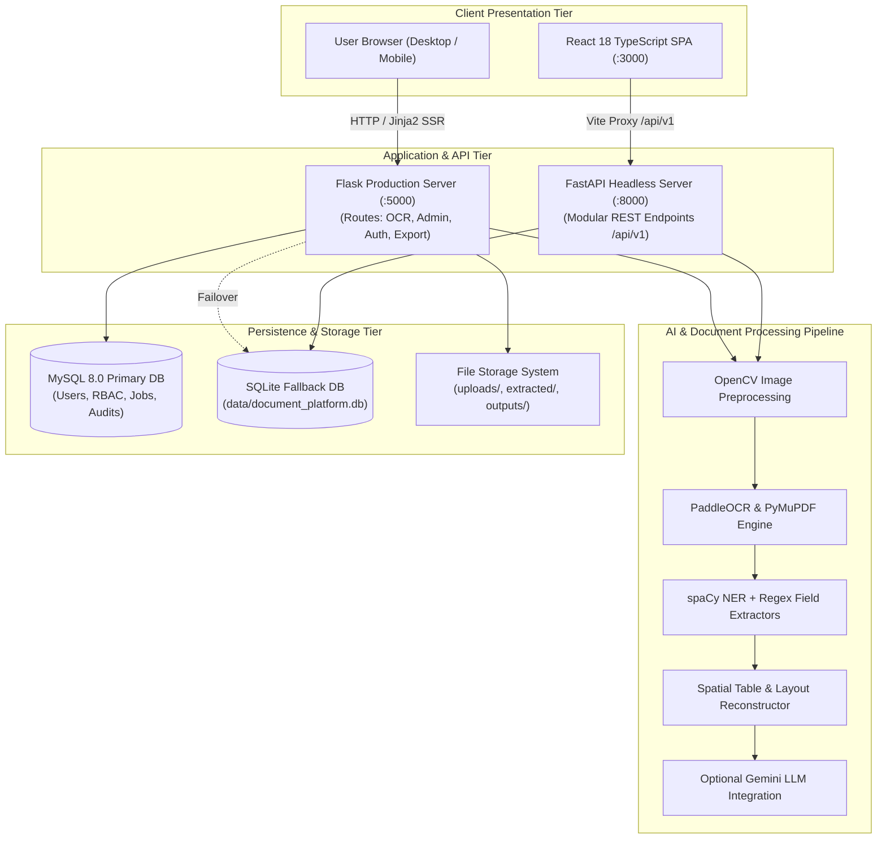
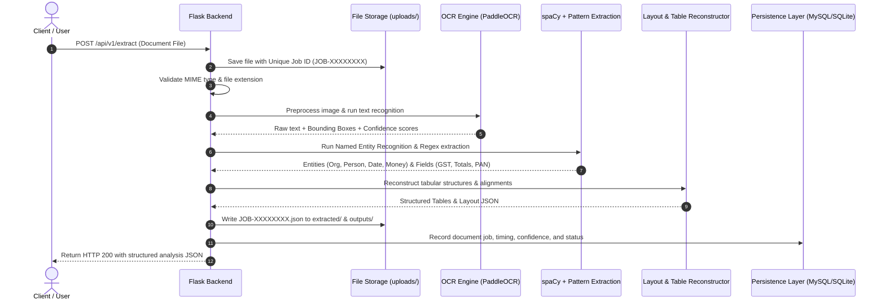
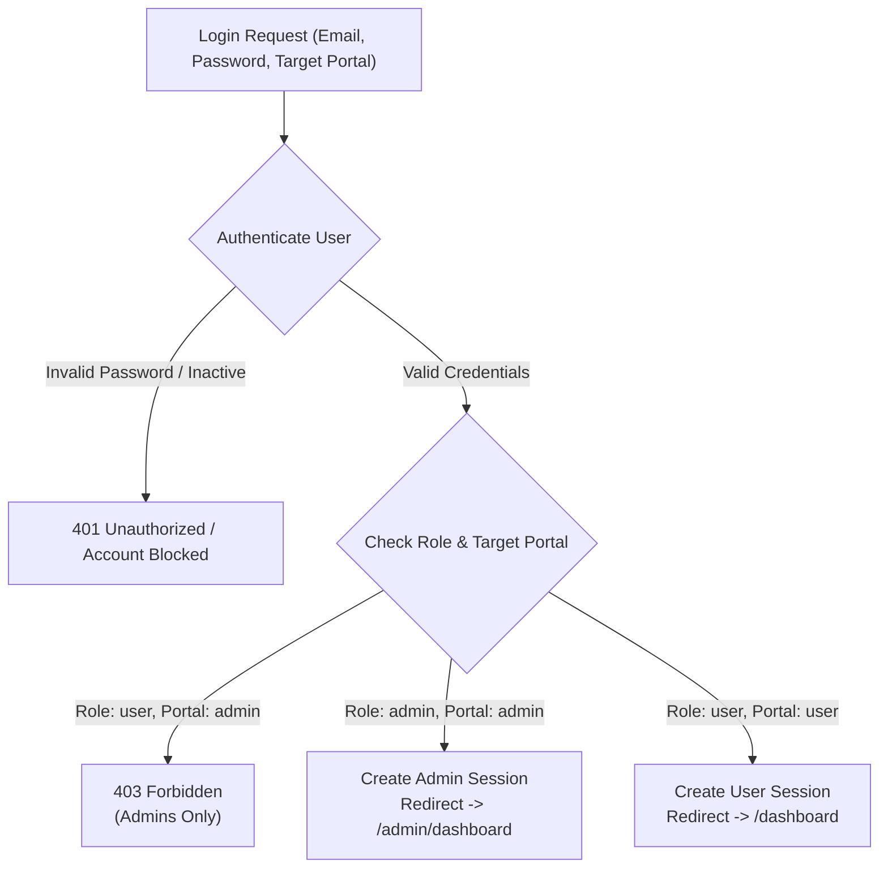

# System Architecture — AI Document Understanding Platform

## 1. High-Level Architecture Overview

The system is engineered using a modular, decoupled architecture supporting both a full-stack monolithic web application and a decoupled headless API tier:

---

## 2. Document Processing & OCR Pipeline

The document pipeline transforms unstructured image or PDF inputs into validated structured records:

---

## 3. Dual-Tier Server Architecture

### Tier 1: Flask Full-Stack Platform (Port 5000)
- **Primary Operational Platform**: Powered by Flask 3.x, serving Jinja2 templates directly to browsers.
- **Components**:
  - `routes/ocr_routes.py`: Upload ingestion, OCR processing, asynchronous progress tracking, sample document demo endpoints.
  - `routes/admin_routes.py`: Protected administrative controllers for RBAC management, audit viewing, and monitoring.
  - `routes/export_routes.py`: Dynamic generation of PDF summaries and CSV exports.
  - `routes/dashboard_routes.py`: Dashboard stats aggregation and job history filtering.

### Tier 2: FastAPI Headless API & React SPA (Ports 8000 & 3000)
- **Modular Microservice**: Powered by FastAPI 0.109 with SQLAlchemy models and Pydantic validation schemas.
- **Frontend SPA**: React 18 with TypeScript, Tailwind CSS, Lucide icons, and Recharts, configured via Vite proxy (`/api -> localhost:8000`).
- **AI Models**: Integrates LayoutLMv3 sequence classification alongside PaddleOCR and spaCy.

---

## 4. Authentication & RBAC Authorization Flow

- Passwords are encrypted using Werkzeug's secure password hash generation (PBKDF2-HMAC-SHA256).
- Session cookies are protected with `HttpOnly` and `SameSite=Lax` flags to prevent XSS cross-site scripting attacks.
